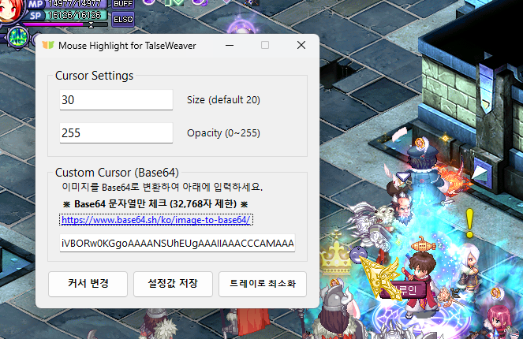
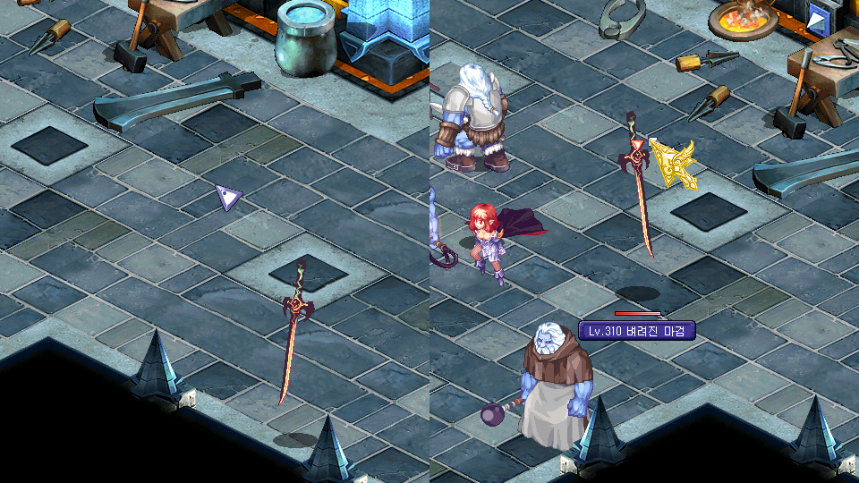
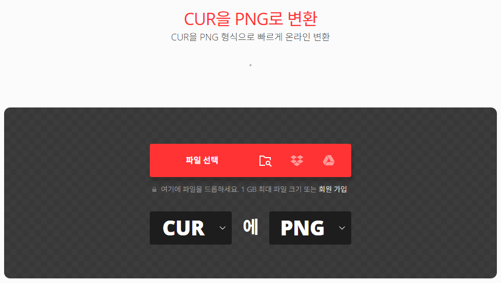
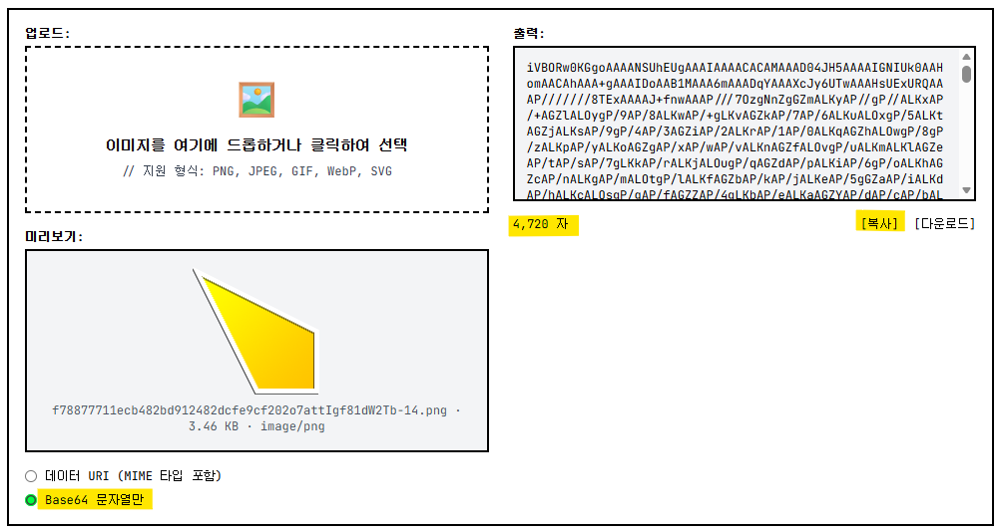
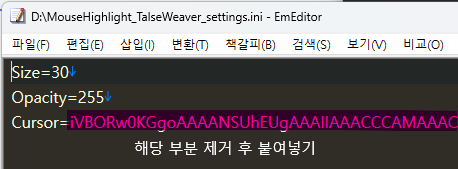

---

## [🛠️제작] 테일즈위버 마우스 커서 하이라이트 프로그램

 
후원금 요구 및 수령 없음. 개별 연락처 운영 안 함(사칭 주의).  
기본 배포처 외 타 경로 다운로드 금지.

---

### 1. 프로그램 소개 및 배경

* 내년 24주년을 맞는 테일즈위버, 우리도 늙고 게임도 늙었다. 게임은 컴퓨터가 돌려주지만 우리의 눈은 이미 많이 혹사된 상태
* 대장간 사냥 등 플레이 시 눈의 피로를 줄이기 위해 시간빌게이츠백수가 해피아워 포기하고 작업
* 외국 제작자(catnip5)의 마우스 하이라이트 프로그램을 커서 덮어쓰기용로 개조 ([제작자 사이트](https://sites.google.com/view/catnip5/mouse-highlight))
* 불필요한 기능 제거 후 커서 크기, 투명도, 변경, 앱 시스템 트레이 최소화 기능만 직관적인 UI로 탑재
* 창모드 및 전체창모드에서만 실행 가능 (전체화면 미지원)

MouseHighlight_TalseWeaver 다운로드 링크 
[https://github.com/Bad-Factory/MouseHighlight_for_TalseWeaver/releases](https://github.com/Bad-Factory/MouseHighlight_for_TalseWeaver/releases)

### 2. 주요 기능 및 사용법

* **직관적인 UI**: 커서 크기와 투명도 조절 기능 제공
* **커서 변경 기능**: 기본 커서가 마음에 안 들거나 시력이 불편한 유저를 위해 추가
* **커서 이미지 설정 방법**:
  1. 사용하고 싶은 커서 파일(`.cur`) 또는 이미지 파일(`.png` 등) 준비
  2. `.cur` 파일은 [Convertio](https://convertio.co/kr/cur-png/)에서 이미지 파일로 변환 필요
   
  

  
  3. 마우스 커서 이미지 파일을 [Base64 변환기](https://www.base64.sh/ko/image-to-base64/)에서 Base64 문자열로 변환
   
  

  
  4. 32,768자를 넘는 경우 고해상도이므로 적당한 크기의 이미지 권장
  5. 초과된 이미지를 꼭 사용하려면 앱 하단 [설정값 저장] 버튼 클릭 후 생성되는 설정 파일을 메모장으로 열어 `[Cursor=]` 뒤의 코드를 교체할 것
   
  

